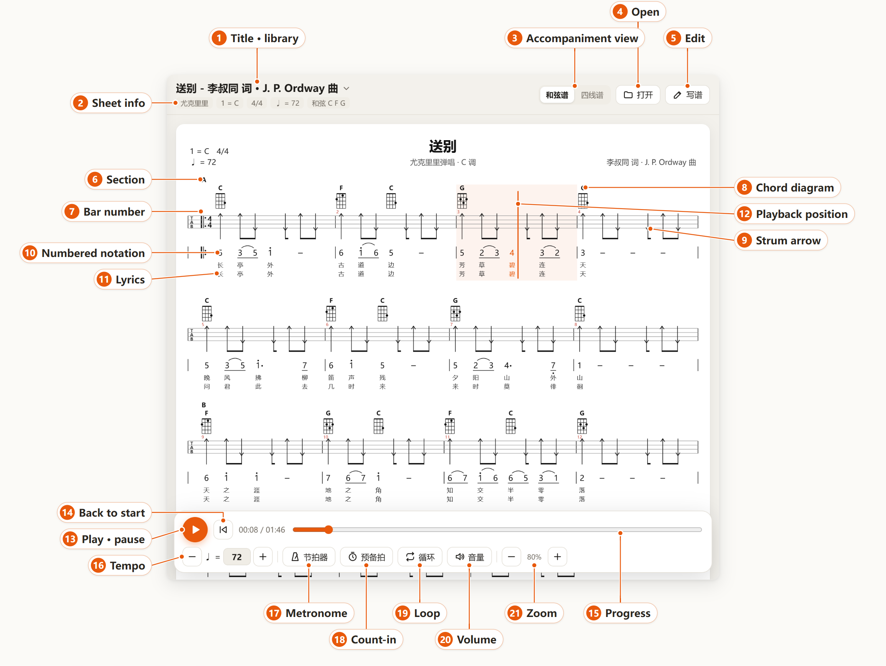
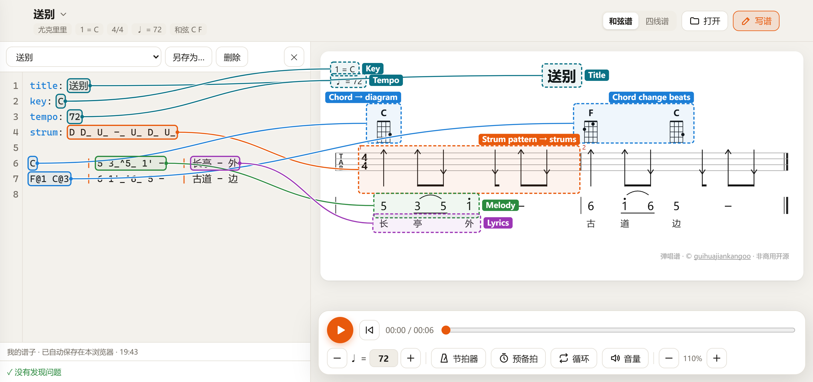
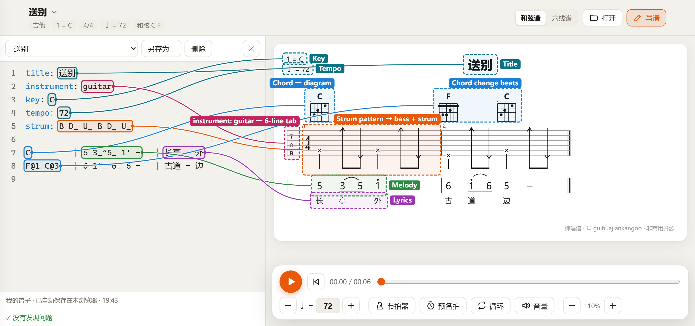

# Tanchang-pu

[中文](README.md) | English

**Tanchang-pu is a browser-based editor and player for ukulele and guitar strum-and-sing sheets.**

Scores are written in a concise plain-text format and rendered in the standard Chinese strum-and-sing layout, including chord diagrams, tablature, numbered notation, and lyrics, with accompaniment and melody playback synchronized to the score.


The interface and the built-in tutorials are currently in Chinese.

## Playback



- **1 Title · library**: shows the current sheet. Click it to open the library, where you can search by title, artist, or lyrics and switch sheets.
- **2 Sheet info**: instrument, key, time signature, tempo, and the chords used in the song.
- **3 Accompaniment view**: 和弦谱 shows only strum direction and rhythm; 四线谱 writes out the fret on every string. For guitar the second option reads 六线谱.
- **4 Open**: imports a `.txt` sheet from your computer or phone. Imported sheets are kept under My sheets.
- **5 Edit**: opens the editor, described in the next section.
- **6 Section**: sections marked in the sheet with labels such as `[主歌]` or `[副歌]`.
- **7 Bar number**: the number of each bar. Error messages in the editor refer to bars by these numbers.
- **8 Chord diagram**: the fingering shown wherever the chord changes. Dots are fretted positions, × marks a string that is not played, and barre chords are drawn with a bar.
- **9 Strum arrow**: an upward arrow is a downstroke and a downward arrow is an upstroke, as in common strum-and-sing sheets. A wavy line is an arpeggio, and × on every string is a muted chop.
- **10 Numbered notation**: the digits 1 to 7 are do to ti. A dot above raises the note an octave and a dot below lowers it; an underline halves the length, and a dash holds the note for another beat.
- **11 Lyrics**: aligned with the notation syllable by syllable. A second verse appears on a second line.
- **12 Playback position**: the current bar is shaded, a vertical line marks the current moment, and the notes and lyrics being played turn orange. Click anywhere on the sheet to jump there.
- **13 Play · pause**: starts or pauses playback; the space bar does the same. During playback the bar collapses to one line; click the arrow on its right to expand it.
- **14 Back to start**: returns to the first bar.
- **15 Progress**: elapsed and total time. Drag to jump.
- **16 Tempo**: set in beats per minute. − and + change it by 5; you can also type a number. Double-click the number to restore the sheet's original tempo.
- **17 Metronome**: adds a click during playback.
- **18 Count-in**: plays one bar of clicks before playback starts.
- **19 Loop**: starts again from the beginning after reaching the end.
- **20 Volume**: sets accompaniment and melody volume separately, or mutes either one. The setting is kept when you switch songs.
- **21 Zoom**: enlarges or shrinks the sheet. On a computer you can also hold Ctrl and scroll the mouse wheel.

## Writing sheets

A sheet is a plain-text `.txt` file. The first lines set the title, key, tempo, and similar information; after that, each line is one bar, split by `|` into four columns: chords, numbered notation, lyrics, and strum pattern. The editor lays the text out as a strum-and-sing sheet as you type and produces accompaniment and melody that can be played right away, with no separate conversion step.

Your sheets are saved in the browser automatically, and Save as stores a copy as a `.txt` file.

The recording below shows one bar being written: with the header lines already in place, the chord, notation, lyrics, and strum pattern are typed in turn, and the sheet on the right updates along the way.


### Ukulele

The text in the editor is on the left and the resulting sheet is on the right; boxes of the same color correspond to each other.



### Guitar

Guitar sheets are written the same way, with one extra line at the top: `instrument: guitar`. The sheet switches to six-line tablature and six-string chord diagrams; `B` in the strum pattern plays the bass note of the current chord and is drawn as ×.



### Syntax reference

The ukulele and guitar tutorials inside the app demonstrate everything below, one feature per bar; click the sheet to jump to the matching line of text.

**Header settings**, one per line:

| Syntax | Effect |
|---|---|
| `title: 送别` | Title |
| `artist: 李叔同` | Composer, lyricist, or performer |
| `subtitle: C 调` | Subtitle |
| `key: C` | Key, meaning 1 = C; `key: E3` also sets the octave |
| `tempo: 72` | Tempo, 72 beats per minute |
| `time: 3/4` | Time signature, 4/4 by default |
| `instrument: guitar` | Guitar sheet; ukulele if omitted. An accompaniment sound number may follow, as in `instrument: guitar 25` |
| `capo: 2` | Capo at the 2nd fret; write frets as usual and playback is transposed automatically |
| `chord: C9=x32333` | Custom chord shape, written from the lowest string to string 1; `x` means not played, and frets of two digits are separated by commas, as in `9,7,8,7` |
| `pattern p1 = D D_ U_ D` | Defines a strum pattern that can later be referred to as `p1` |
| `strum: p1` | Default strum pattern for all following bars |
| `accomp: tab` | Shows full tablature by default |
| `melody: 0` | Melody sound as a General MIDI number; the default is 10, music box, and the accompaniment defaults to 12, marimba |
| `tuning: G3 C4 E4 A4` | Custom tuning, for example a low-G ukulele |

**Chord column**:

| Syntax | On the sheet |
|---|---|
| `C` | One chord for the whole bar, with a diagram at the start of the bar |
| `C Am` | Two chords splitting the bar evenly |
| `F@1 C@3` | F from beat 1 and C from beat 3, each diagram drawn at its beat |
| empty | Keeps the previous chord without drawing it again |
| `N` | No chord in this bar |

Common chords need no definition. The ukulele has C, D, E, F, G, A, Am, Dm, Em, G7, Bm and more built in; the guitar has C, D, E, F, G, A, Am, Dm, Em, G7, Bm, Cadd9, G/B and more.

**Notation column**:

| Syntax | On the sheet |
|---|---|
| `1` to `7` | Notes do to ti, quarter notes by default |
| `0` | Rest |
| `1_`, `1__`, `1___` | Eighth, sixteenth, and thirty-second notes, drawn with one to three underlines |
| `1.` | Dotted note, with a dot to the right |
| `-` | Holds the previous note for another beat, drawn as a dash |
| `1'`, `5,` | One octave up or down, drawn as a dot above or below; they can be stacked, as in `1''` |
| `#4`, `b7` | Sharp and flat |
| `3_~3_` | Tie to the next note of the same pitch, which gets no new syllable; ties may cross bar lines |
| `2_^1_` | Slur, drawn as an arc, with each note getting its own syllable |
| `5_3__2__` | Short notes within one beat can be written together without spaces |

**Lyrics column**:

| Syntax | On the sheet |
|---|---|
| `长亭外` | One Chinese character per note |
| `-` | This note gets no syllable |
| `长亭外 / 问君此去` | `/` separates the first and second verses, which appear on two lines, each aligned with the notes |
| `hello world` | Words separated by spaces, one word per note |

**Strum pattern column**: if left empty, the default from `strum:` is used. Durations are written as in the notation column, so `D_` is an eighth-note downstroke. A pattern shorter than the bar is repeated.

| Syntax | On the sheet |
|---|---|
| `D`, `U` | Downstroke and upstroke, drawn as an arrow across the strings |
| `X` | Muted chop, × on every string |
| `R` | Arpeggio, drawn as a wavy line |
| `B` | Bass note of the current chord, drawn as × |
| `-` | Silent beat |
| `~` | Holds the previous stroke for another beat |
| `7.1_` | Single note: string 1, fret 7, an eighth note, with the fret number written on the tab |
| `0.1+1.2_` | Several strings at once |
| `x.2_` | Muted string |
| `1h.3__ 3.3__` | Hammer-on or pull-off to the next note, drawn as an arc |
| `3s.2__ 5.2__` | Slide to the next note, drawn as a slanted line |
| `3.1_t 2.1_t 3.2_t` | Triplet |
| `*.3_` | String 3 of the chord being held, drawn as ×; the fret follows the chord when it changes |
| `p1` | A pattern defined with `pattern` |

**Sections, repeats, and time changes**, one per line:

| Syntax | On the sheet |
|---|---|
| `[副歌]` | Section name, shown above the next bar |
| `\|:` | A repeat starts at the next bar |
| `:\|`, `:\| x3` | The repeat ends at the previous bar; it plays twice by default, and `x3` plays it three times |
| `ending: 1` | The next bar is the first ending; `ending: 2` marks the second |
| `time: 2/4` | Switches to 2/4 from the next bar |
| `# comment` | Comment, ignored on the sheet; `#` must be followed by a space |

**Guitar compared with ukulele**:

| Item | Ukulele | Guitar |
|---|---|---|
| Header | nothing extra | `instrument: guitar` |
| Tablature | four lines | six lines |
| Chord shapes | string 4 to string 1, as in `C=0003` | string 6 to string 1, as in `C=x32010` |
| Single-note strings | 1 to 4 | 1 to 6 |

## Try it online

Link to be added after launch.

## Run it locally

Requires [Node.js](https://nodejs.org) and Python 3. The first build downloads the playback engine and sound font, about 3 MB in total.

```bash
node tools/build_app.js dist      # build the offline-capable version into dist/
python tools/serve.py 8790 dist   # serve it, then open http://127.0.0.1:8790
```

To add your own sheets, put `.txt` files in `songs/` and run `node tools/build_library.js`.

## License

**Commercial use is not permitted.** This project is licensed under the [PolyForm Noncommercial License 1.0.0](LICENSE): you may study, use, modify, and share it for noncommercial purposes. Any commercial use, including selling it, monetizing it with ads, or using it in a commercial product or service, requires the author's written permission; contact [@guihuajiankangoo](https://github.com/guihuajiankangoo).

This project is source-available; it is not open source as defined by the OSI.

The example sheets include only public-domain works. Please do not submit copyrighted material.

The author keeps a description of this project's distinguishing features; its SHA-256 is `6ef3da471f53c1cb931ac27a046d6768b1f12636eb36d343d1fa64bb3ed62ed9`.

The code and documentation were developed with the assistance of [Claude](https://claude.ai) by Anthropic.

Third-party components: [alphaTab](https://alphatab.net) handles parsing and playback under the MPL-2.0 license; the Bravura font is licensed under OFL-1.1; the sonivox sound font is licensed under Apache-2.0. See [NOTICE](NOTICE).
