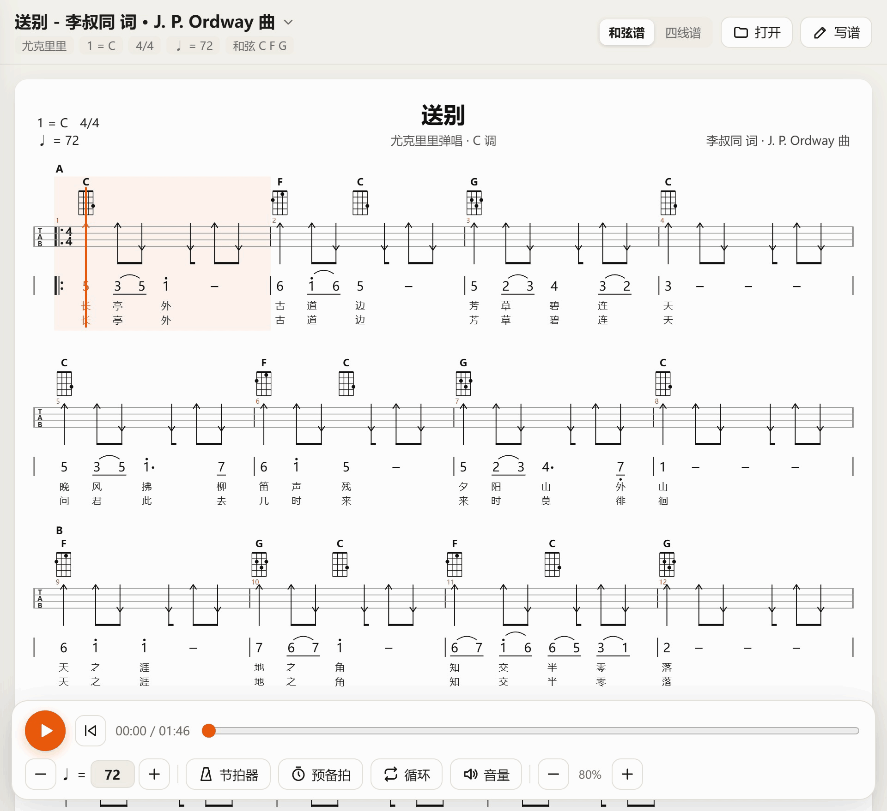
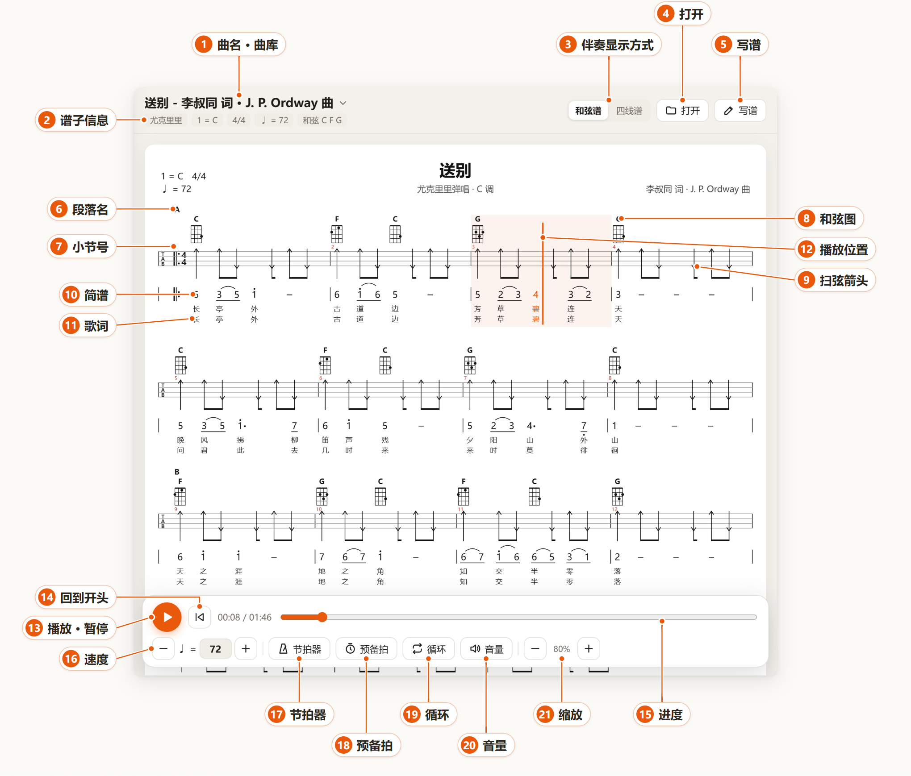
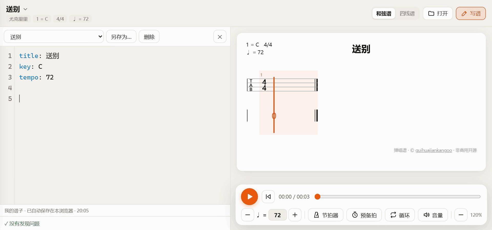
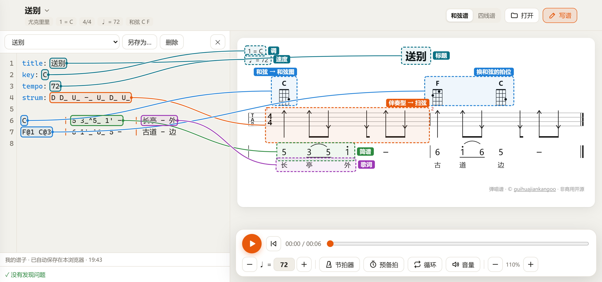
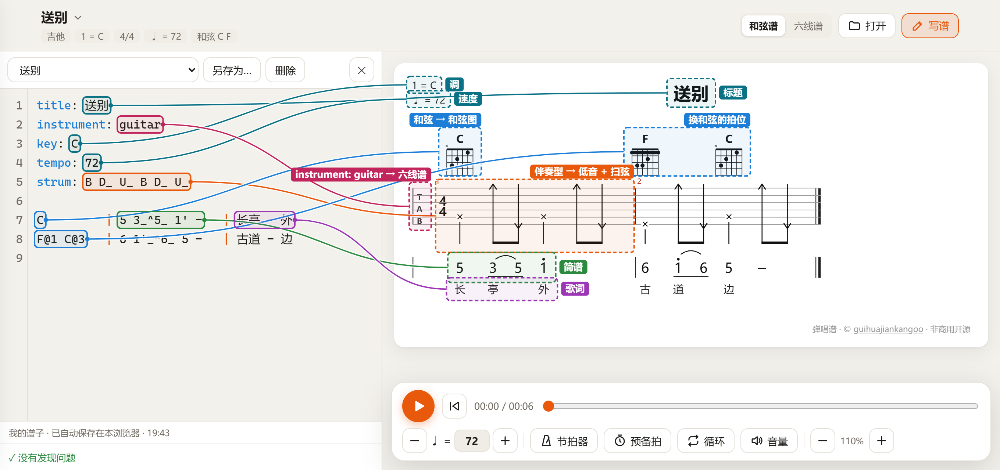

# 弹唱谱

中文 | [English](README.en.md)

**弹唱谱是一个基于浏览器的尤克里里与吉他弹唱谱编辑和播放工具。**

以简洁的文本格式记谱，自动渲染为标准的弹唱谱版式，包括和弦图、指法谱、简谱与歌词，并提供与谱面同步的伴奏和旋律回放。

**在线使用：** https://guihuajiankangoo.github.io/tanchang-pu/



## 播放



- **1 曲名 · 曲库**：显示当前谱子。点击打开曲库，可以按歌名、歌手或歌词搜索并切换谱子。
- **2 谱子信息**：乐器、调、拍号、速度，以及这首歌用到的和弦。
- **3 伴奏显示方式**：「和弦谱」只标出扫弦方向和节奏，「四线谱」写出每根弦的品位。吉他谱显示为「六线谱」。
- **4 打开**：导入电脑或手机上的 `.txt` 谱子，导入后保存在「我的谱子」中。
- **5 写谱**：打开编辑器，见下一节。
- **6 段落名**：谱子里用 `[主歌]`、`[副歌]` 等标出的段落。
- **7 小节号**：每个小节的编号，编辑器的错误提示也按小节号指出位置。
- **8 和弦图**：在换和弦的位置显示指法。黑点是按弦位置，× 表示这根弦不弹，需要横按的和弦会画出横杠。
- **9 扫弦箭头**：箭头朝上表示下扫，朝下表示上扫，与常见弹唱谱的画法一致。波浪线表示琶音，每根弦上的 × 表示切音。
- **10 简谱**：数字 1 到 7 对应 do 到 si。上方加点为高八度，下方加点为低八度，下划线表示时值减半，横线表示延长一拍。
- **11 歌词**：与简谱逐字对齐，有两段歌词时分上下两行显示。
- **12 播放位置**：当前小节显示底色，竖线标出当前时刻，正在演奏的音符和歌词变为橙色。点击谱面任意位置可以跳到那里。
- **13 播放 · 暂停**：开始或暂停播放，也可以按空格键。播放时播放条会收起成一行，点击右侧的箭头可以展开。
- **14 回到开头**：回到第一小节。
- **15 进度**：显示已播放时间和总时长，拖动可以跳转。
- **16 速度**：按每分钟拍数设定。点击 − 或 + 每次调整 5 拍，也可以直接输入数字，双击数字恢复谱子的原速。
- **17 节拍器**：播放时加入节拍声。
- **18 预备拍**：开始播放前先打一小节拍子。
- **19 循环**：播放到结尾后自动从头开始。
- **20 音量**：分别调节伴奏和旋律的音量，也可以单独静音。设置会保留，换歌后依然有效。
- **21 缩放**：放大或缩小谱面。在电脑上也可以按住 Ctrl 滚动鼠标滚轮。

## 写谱

谱子是纯文本的 `.txt` 文件。开头几行设定标题、调、速度等信息，之后每行写一个小节，用 `|` 分成四栏：和弦、简谱、歌词、伴奏型。编辑器会即时把文本排成弹唱谱，并生成可以直接播放的伴奏和旋律，不需要另外转换。

写好的谱子自动保存在浏览器里，也可以用「另存为」存成 `.txt` 文件。

下图是写一个小节的过程：开头几行已经写好，依次输入和弦、简谱、歌词和伴奏型，右侧的谱面随之更新。



### 尤克里里

下图左侧是编辑器里的文本，右侧是生成的谱面，同一颜色的框表示对应关系。



### 吉他

写法与尤克里里相同，只需在开头加一行 `instrument: guitar`。谱面随之改为六线谱，和弦图改为六根弦；伴奏型里的 `B` 表示弹奏当前和弦的低音，谱上画成 ×。



### 写法参考

网页中的「尤克里里写法教程」和「吉他写法教程」逐项演示了下面的写法，每种写法占一个小节，点击谱面就能对照到文本中对应的那一行。

**开头设置**，每项单独一行：

| 写法 | 作用 |
|---|---|
| `title: 送别` | 标题 |
| `artist: 李叔同` | 词曲作者或歌手 |
| `subtitle: C 调` | 副标题 |
| `key: C` | 调，即 1 = C；写成 `key: E3` 可以指定八度 |
| `tempo: 72` | 速度，每分钟 72 拍 |
| `time: 3/4` | 拍号，默认 4/4 |
| `instrument: guitar` | 吉他谱，不写则为尤克里里；后面可以加伴奏音色编号，如 `instrument: guitar 25` |
| `capo: 2` | 变调夹夹在第 2 品；品位照常写，播放时自动升调 |
| `chord: C9=x32333` | 自定义和弦指法，从最低的弦写到 1 弦，`x` 表示不弹，两位数的品用逗号分隔，如 `9,7,8,7` |
| `pattern p1 = D D_ U_ D` | 定义一个伴奏型，之后用名字 `p1` 引用 |
| `strum: p1` | 之后所有小节默认使用的伴奏型 |
| `accomp: tab` | 默认显示完整的四线谱或六线谱 |
| `melody: 0` | 旋律音色，使用 General MIDI 编号，默认 10 八音盒；伴奏默认 12 马林巴 |
| `tuning: G3 C4 E4 A4` | 自定义调弦，例如低音 G 的尤克里里 |

**和弦栏**：

| 写法 | 谱上显示 |
|---|---|
| `C` | 整个小节一个和弦，在小节开头画和弦图 |
| `C Am` | 两个和弦平分小节 |
| `F@1 C@3` | 第 1 拍换 F，第 3 拍换 C，和弦图画在对应的拍上 |
| 留空 | 沿用上一个和弦，不重复画和弦图 |
| `N` | 这一小节不弹和弦 |

常用和弦不必定义：尤克里里内置 C、D、E、F、G、A、Am、Dm、Em、G7、Bm 等，吉他内置 C、D、E、F、G、A、Am、Dm、Em、G7、Bm、Cadd9、G/B 等。

**简谱栏**：

| 写法 | 谱上显示 |
|---|---|
| `1` 到 `7` | 音符 do 到 si，默认四分音符 |
| `0` | 休止符 |
| `1_`、`1__`、`1___` | 八分、十六分、三十二分音符，数字下方画一到三条下划线 |
| `1.` | 附点音符，数字右侧画点 |
| `-` | 前一个音延长一拍，画一条横线 |
| `1'`、`5,` | 高八度、低八度，数字上方或下方画点；可以叠加，如 `1''` |
| `#4`、`b7` | 升号、降号 |
| `3_~3_` | 连音线，连到下一个同音，后一个音不唱新字，可以跨小节 |
| `2_^1_` | 圆滑线，画弧线，两个音各唱各的字 |
| `5_3__2__` | 同一拍内的短音可以连写，不用空格 |

**歌词栏**：

| 写法 | 谱上显示 |
|---|---|
| `长亭外` | 中文一个字对应一个音 |
| `-` | 这个音不配字 |
| `长亭外 / 问君此去` | `/` 分隔第一段和第二段歌词，分上下两行显示，各自与音符对齐 |
| `hello world` | 英文按空格分词，一个词对应一个音 |

**伴奏型栏**：不写时使用 `strum:` 设定的默认伴奏型。时值写法与简谱相同，例如 `D_` 是八分音符的下扫。伴奏型长度不足一小节时会循环使用。

| 写法 | 谱上显示 |
|---|---|
| `D`、`U` | 下扫、上扫，画成贯穿各弦的箭头 |
| `X` | 切音，每根弦上画 × |
| `R` | 琶音，画成波浪线 |
| `B` | 弹当前和弦的低音，画成 × |
| `-` | 空拍 |
| `~` | 前一个动作再延长一拍 |
| `7.1_` | 单音：1 弦 7 品，八分音符，谱上写出品位数字 |
| `0.1+1.2_` | 同时弹几根弦 |
| `x.2_` | 这根弦闷音 |
| `1h.3__ 3.3__` | 击弦或勾弦到下一个音，画弧线 |
| `3s.2__ 5.2__` | 滑音到下一个音，画斜线 |
| `3.1_t 2.1_t 3.2_t` | 三连音 |
| `*.3_` | 按住当前和弦弹第 3 弦，画成 ×；换和弦时品位自动跟着变 |
| `p1` | 使用 `pattern` 定义的伴奏型 |

**段落、反复和拍号**，每项单独一行：

| 写法 | 谱上显示 |
|---|---|
| `[副歌]` | 段落名，标在下一小节上方 |
| `\|:` | 下一小节开始反复 |
| `:\|`、`:\| x3` | 上一小节结束反复，默认反复两遍，`x3` 表示三遍 |
| `ending: 1` | 下一小节是第一房子，`ending: 2` 是第二房子 |
| `time: 2/4` | 从下一小节起改为 2/4 拍 |
| `# 注释` | 注释，不影响谱面；`#` 后面要有空格 |

**吉他与尤克里里的区别**：

| 项目 | 尤克里里 | 吉他 |
|---|---|---|
| 开头设置 | 不用写 | `instrument: guitar` |
| 指法谱 | 四线谱 | 六线谱 |
| 和弦指法的写法 | 从 4 弦写到 1 弦，如 `C=0003` | 从 6 弦写到 1 弦，如 `C=x32010` |
| 单音的弦号 | 1 到 4 | 1 到 6 |

## 在线使用

地址：https://guihuajiankangoo.github.io/tanchang-pu/

- 地址长期有效，仓库更新后会自动同步到网站。
- 网站部署在 GitHub Pages，服务器位于境外，国内部分网络下打开较慢。
- 打开过一次后，页面和音色会缓存在本地，之后没有网络也能使用。
- 在手机或平板上，可以用浏览器的「添加到主屏幕」把它安装成应用。

## 在本地运行

需要 [Node.js](https://nodejs.org) 和 Python 3。第一次构建时会联网下载播放引擎和音色，约 3 MB。

```bash
node tools/build_app.js dist      # 构建可离线使用的版本，输出到 dist/
python tools/serve.py 8790 dist   # 启动本地服务，然后在浏览器打开 http://127.0.0.1:8790
```

要加入自己的谱子，把 `.txt` 文件放进 `songs/`，再运行 `node tools/build_library.js`。

## 许可

**禁止商用。** 本项目采用 [PolyForm Noncommercial 1.0.0](LICENSE) 许可：可以学习、自用、修改，也可以非商业地分享；任何商业用途，包括收费、广告、用于商业产品或服务，都需要作者的书面许可，请联系 [@guihuajiankangoo](https://github.com/guihuajiankangoo)。

本项目属于「源码公开」，不属于 OSI 定义的「开源」。

示例谱子只收录公有领域的作品，请不要提交有版权的谱子。

作者留存了一份本项目的特征说明，SHA-256：`6ef3da471f53c1cb931ac27a046d6768b1f12636eb36d343d1fa64bb3ed62ed9`

本项目的代码和文档在 Anthropic 的 [Claude](https://claude.ai) 协助下完成。

第三方组件：[alphaTab](https://alphatab.net) 负责解析和播放，采用 MPL-2.0 许可；Bravura 字体采用 OFL-1.1 许可；sonivox 音色库采用 Apache-2.0 许可。详见 [NOTICE](NOTICE)。
